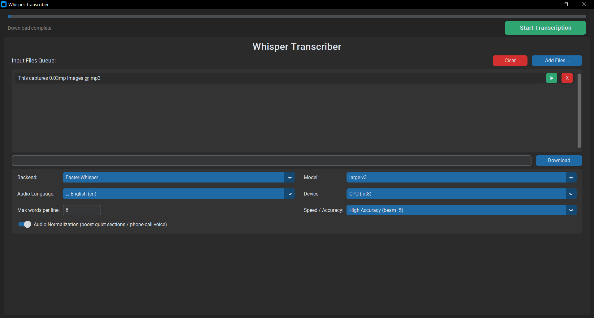
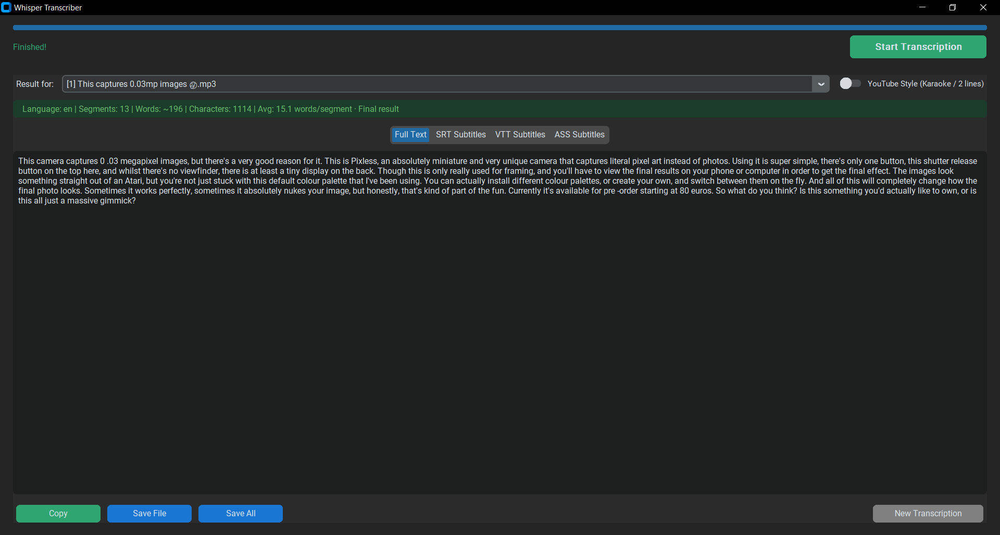
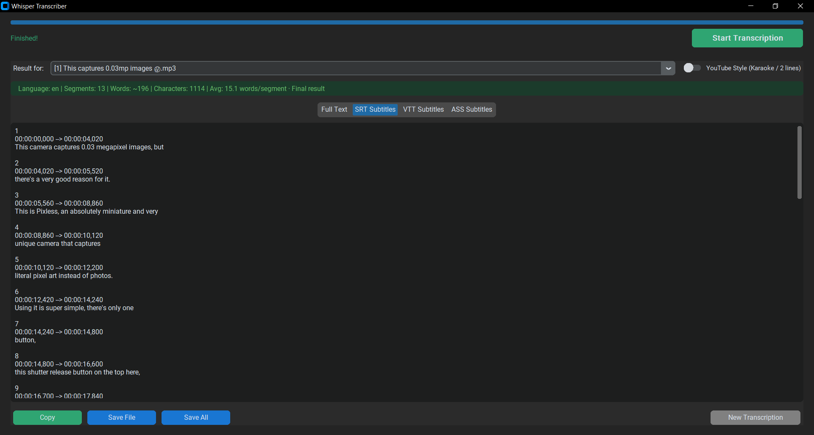

<a id="readme-top"></a>

# 🎬 local-subs-generator — Local Subtitle Generator with GUI

[](https://www.python.org/downloads/)
[](https://github.com/TomSchimansky/CustomTkinter)
[](https://github.com/openai/whisper)
[](https://github.com/SYSTRAN/faster-whisper)
[](https://opensource.org/licenses/MIT)

A powerful **local desktop application** for automatic speech recognition and subtitle generation. Everything runs on your machine: **no cloud, no internet required**, and your audio and video files never leave your computer. It supports both **Faster-Whisper** and **OpenAI Whisper** backends, exports `.TXT`, `.SRT`, `.VTT`, and `.ASS` formats, and processes **multiple files in a queue** with direct video/URL transcription, all from a clean dark-themed GUI.

---

## ✨ Features
- 🖥️ **Desktop GUI** — built with CustomTkinter, modern dark theme, clean layout.
- 📂 **Batch File Queue** — queue and transcribe multiple files sequentially.
- 🔀 **Dual Backend** — switch between **Faster-Whisper** (CTranslate2) and **OpenAI Whisper**.
- ⚙️ **Hardware & Speed Control** — select device (`Auto`, `CPU`, `CUDA`) and adjust accuracy vs. speed with `beam_size`.
- 🌍 **Multilingual** — 25+ languages plus automatic language identification.
- 📝 **Four Output Formats** — plain text (`.TXT`), subtitles (`.SRT`), WebVTT (`.VTT`), and advanced subtitles (`.ASS`).
- ✏️ **Editable Transcripts** — edit text directly in the app before saving, with full Undo/Redo support.
- 🎬 **YouTube-Style Subtitles** — cumulative word-by-word roll-up and karaoke-style timing tags (`{\k}`).
- 🔗 **Direct URL Download** — paste video links (YouTube, TikTok, etc.) and transcribe them automatically via yt-dlp.



---

## 🎯 Use Cases & Practical Workflows

### Transcribe a Specific Audio Track from Multi-Track MKV Videos
When working with dual-audio anime, movies, or multi-language recordings, you do not need to demux or extract audio manually with external tools. Load any `.mkv` file into the queue and open the **Choose a different audio track** dialog to inspect every embedded stream by index, language tag, codec, and channel layout (e.g., `Track #1 · jpn · AAC · stereo`), or let the app select the default track automatically.

### Generate ASS Subtitles with Karaoke Timing Placeholders (`{\k}`)
Designed for fansubbers, translators, and video editors who work in Aegisub or Subtitle Edit. Beyond standard `.srt`, `.vtt`, and `.txt` exports, `local-subs-generator` outputs Advanced SubStation Alpha (`.ass`) files complete with `{\k}` timing tags for silent pauses, smart sentence-boundary line wrapping, and preserved punctuation (hyphenated compounds, decimals, timestamps, and percentages).

### Improve Speech Recognition on Quiet or Noisy Audio via FFmpeg
Low-volume voice recordings, distant microphones, and background rumble often cause Whisper models to miss words or hallucinate. Enabling the built-in **FFmpeg audio preprocessing filter** applies a `highpass=80Hz` filter paired with `dynaudnorm` (dynamic audio normalization) before transcription, leveling quiet speech segments without manual DAW editing.

### Direct YouTube & Online Video Transcription (`yt-dlp`)
Paste one or multiple video URLs directly into the application to fetch audio and generate clean subtitles in a single step. Built-in pause detection automatically clears on-screen text during silent gaps longer than `2.0s` so captions never linger over empty scenes, while automatic startup checks keep `yt-dlp` up to date.

### Batch-Transcribe Large Video Queues Offline on CPU or GPU
Process entire seasons or lecture series unattended. Heavy models (`large-v3`, `medium`) stay cached in RAM across queued files to eliminate repeated loading delays, while automatic CPU logical thread detection and selectable `beam_size` presets (High Accuracy, Balanced, Fast CPU) let you tune speed vs. precision for your hardware.

---

## 🧠 Supported Models

### Faster-Whisper
| Model | Notes |
|---|---|
| `tiny` / `tiny.en` | Fastest, lowest accuracy |
| `base` / `base.en` | **Good default for most use cases** |
| `small` / `small.en` | Better accuracy |
| `medium` / `medium.en` | High accuracy |
| `large-v1` / `large-v2` / `large-v3` | Best accuracy, higher resource usage |
| `large-v3-turbo` | Fast and accurate, optimized large model |
| `distil-small.en` | Distilled, English-only, fast |
| `distil-medium.en` | Distilled, English-only, balanced |
| `distil-large-v2` / `distil-large-v3` | Distilled large, fast and accurate |

### OpenAI Whisper
`tiny` · `base` · `small` · `medium` · `large` · `turbo`

### 💡 Choosing by RAM
| RAM | Recommended |
|---|---|
| 4 GB | `tiny` or `base` |
| 8 GB | `small` or `medium` |
| 16+ GB | Any model, including `large-v3` |

> **NVIDIA GPU?** All models run significantly faster via CUDA — detected and used automatically.

---

## 🌍 Supported Languages

Ukrainian · English · German · French · Spanish · Italian · Japanese · Chinese · Korean · Portuguese · Russian · Polish · Dutch · Arabic · Turkish · Swedish · Finnish · Danish · Czech · Slovak · Romanian · Hungarian · Bulgarian · Greek · Hebrew · Hindi · Indonesian · **+ Auto-detect**

---

## 🚀 Quick Start

### Requirements

- **Python 3.11** (best option — other versions may not run)
- **FFmpeg** — must be installed and available in your system `PATH`

### Installing FFmpeg

**Windows:**
```bash
choco install ffmpeg
# or download from https://ffmpeg.org/download.html
```

**macOS:**
```bash
brew install ffmpeg
```

**Linux (Ubuntu/Debian):**
```bash
sudo apt-get update && sudo apt-get install ffmpeg
```

### Installation

1. **Clone the repository:**
```bash
git clone https://github.com/BlackPencil-69/local-subs-generator.git
cd local-subs-generator
```

2. **Create a virtual environment:**
```bash
py -3.11 -m venv venv
```

3. **Activate it:**

Windows:
```bash
venv\Scripts\activate
```
macOS / Linux:
```bash
source venv/bin/activate
```

4. **Install dependencies:**
```bash
pip install -r requirements.txt
```

5. **Launch the app:**
```bash
python main.py
```

---

## 📖 How to Use

1. **Add files** — drag & drop media files onto the queue, or click **Add Files...** or paste the link
2. **Configure settings** — choose backend, model, language, compute device, speed/accuracy (beam_size), max words per line, and toggle audio normalization if needed.
3. **Start** — click **Start Transcription** and watch the progress bar with ETA
4. **Review results** — switch between **Full Text**, **SRT Subtitles**, **VTT Subtitles** and **ASS Subtitles** tabs
5. **Toggle YouTube Style** [Beta] — turn on the YouTube Style switch in the top right corner if you want word-by-word cumulative subtitle generation.
6. **Edit & Export** — tweak any typos directly in the text view if needed, then copy to clipboard, save the current file, or click Save All to export all formats at once.
7. **New session** — click **New Transcription** to go back and process more files




---

## 🔧 Technologies

- **GUI:** CustomTkinter + Tkinter
- **AI (primary):** faster-whisper (CTranslate2)
- **AI (alternative):** openai-whisper
- **Media processing:** FFmpeg + PyAV
- **Drag & Drop:** tkinterdnd2-universal
- **Logging:** Python `logging` with file output to `%APPDATA%\WhisperTranscriber\app.log`

---

## 🐛 Troubleshooting

### FFmpeg not found
```bash
ffmpeg -version
# If it fails, reinstall or add ffmpeg to your PATH
```

### GPU not being used / Forcing CPU
The app automatically detects CUDA if compatible libraries are installed. You can also explicitly select your hardware using the **Device** dropdown in the settings (`Auto`, `CPU (int8)`, or `CUDA (GPU)`). If CUDA is unavailable, it will safely fall back to CPU.

### MemoryError
- Switch to a smaller model (`tiny` or `base`)
- Close other memory-heavy applications

### Drag & Drop not working
The app will print a warning on launch if `tkinterdnd2` failed to load. Try reinstalling it:
```bash
pip install tkinterdnd2-universal
```

### Slow transcription
- Use a smaller or distilled model
- Check if GPU is being used (shown in the console log)
- Try a shorter file to test

### YouTube links/URL Transcription failing
If downloading video or audio from a link fails, it is usually because the underlying `yt-dlp` library is outdated. YouTube and other platforms frequently update their code, so you need to keep `yt-dlp` up to date:
```bash
pip install --upgrade yt-dlp
```

---

## ❓ Frequently Asked Questions (FAQ)

**Does `local-subs-generator` require an internet connection?**
No. Once `faster-whisper` or `openai-whisper` models are downloaded, all audio and video transcription runs 100% locally on your CPU or NVIDIA GPU. Internet access is only used when transcribing directly from a URL via `yt-dlp`.

**Why are there two Whisper engines (OpenAI Whisper vs. faster-whisper)?**
`faster-whisper` uses CTranslate2 to run up to 4x faster with significantly lower RAM/VRAM usage, making it ideal for most systems. The original `openai-whisper` backend is included as a fallback option for maximum compatibility.

**Which subtitle and media formats are supported?**
You can import any audio or video format supported by FFmpeg (`.mp4`, `.mkv`, `.avi`, `.mov`, `.mp3`, `.wav`, `.flac`, `.ogg`, `.m4a`) and export subtitles to `.srt`, `.ass`, `.vtt`, or plain `.txt`. All formats are generated in a single transcription pass.

---

## 📝 License

Distributed under the MIT License. See `LICENSE` for details.

---

## 🙏 Acknowledgements

- [faster-whisper](https://github.com/SYSTRAN/faster-whisper) — optimized Whisper via CTranslate2
- [openai/whisper](https://github.com/openai/whisper) — original Whisper model
- [CustomTkinter](https://github.com/TomSchimansky/CustomTkinter) — modern Tkinter UI
- [FFmpeg](https://ffmpeg.org/) — media processing
- [yt-dlp](https://github.com/yt-dlp/yt-dlp) — advanced video/audio download utility
- [Claude](https://claude.ai/) — AI assistance in generating the core architecture
- [Gemini](https://gemini.google.com/) — AI assistance in debugging, refactoring, and feature expansion

---

## 📧 Contact

GitHub: [@BlackPencil-69](https://github.com/BlackPencil-69/)  
Telegram: [@MrKap1toshka](https://t.me/MrKap1toshka)  
Discord: [@anonym_pro](https://discord.com/users/1149264703470698529)

**Project:** [https://github.com/BlackPencil-69/local-subs-generator](https://github.com/BlackPencil-69/local-subs-generator)

---

**⭐ If this project helped you, please give it a star!**

<p align="right">(<a href="#readme-top">back to top</a>)</p>
